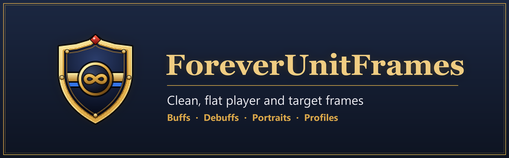
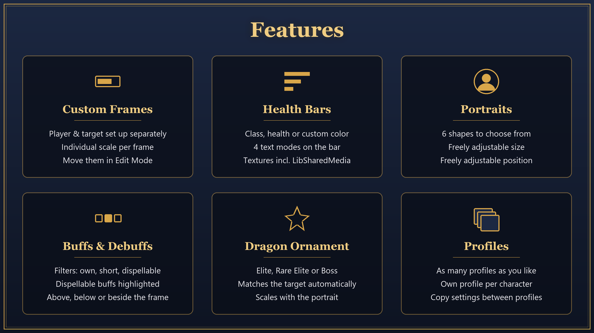
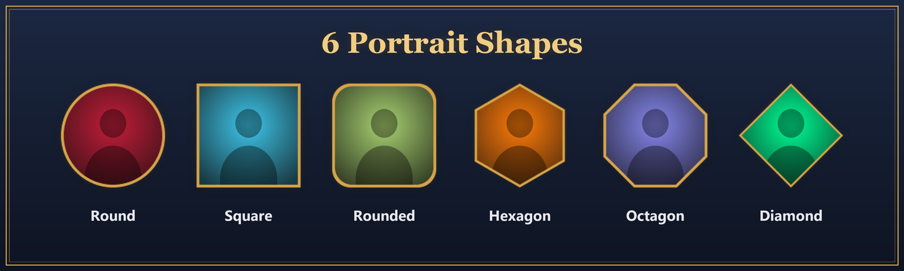
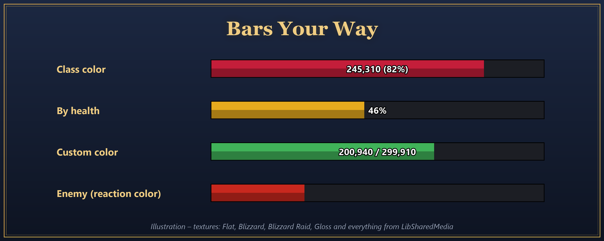

# ForeverUnitFrames

Clean, flat **player and target frames** for World of Warcraft with buffs, debuffs, portraits and profiles – every frame configured on its own, with a live preview in the settings.



## Features

- **Separate player and target frames** – own scale, colors, texture and portrait for each
- **Health bars** – class color, by health or custom color; four text modes; built-in textures plus everything from [LibSharedMedia](https://www.curseforge.com/wow/addons/libsharedmedia-3-0)
- **Portraits** in six shapes (round, rounded, square, diamond, hexagon, octagon) with adjustable size and position
- **Buffs & debuffs** – filters (own, short, dispellable/stealable), adjustable icon size and count, highlighting of dispellable enemy buffs
- **Dragon ornament** – Elite, Rare Elite or Boss; matches the target automatically
- **Profiles** – any number of profiles, one per character, copy settings between them
- **Edit Mode support** – move the frames with Blizzard's Edit Mode
- Optionally hides Blizzard's player/target frames and buff/debuff bars





## Installation

1. Download the latest release zip (or the CurseForge file).
2. Extract it into `World of Warcraft\_retail_\Interface\AddOns\`, so the folder structure is:
   ```
   Interface\AddOns\ForeverUnitFrames\ForeverUnitFrames.toc
   ```
3. Restart the game or type `/reload`.

To install from source, clone the repository into a folder named exactly `ForeverUnitFrames` – WoW only loads the addon if the folder name matches the `.toc` file.

## Usage

| Command | Description |
|---|---|
| `/ff` | Open the settings |
| `/ff unlock` | Open Edit Mode to move the frames |
| `/foreverframes` | Same as `/ff` |

Settings are also available under **Options → AddOns → ForeverUnitFrames**.

**Notes**
- The settings UI is currently in **German** only.
- Showing Blizzard's frames again only takes effect after `/reload`.
- Cancelling buffs with a right-click only works through Blizzard's buff bar.

## Project Structure

| File | Purpose |
|---|---|
| `ForeverUnitFrames.toc` | Addon metadata and load order |
| `Core.lua` | Saved variables, profiles, events, slash commands |
| `Auras.lua` | Buff and debuff handling |
| `Frames.lua` | Player and target frames, bars, portraits, ornaments |
| `Options.lua` | Settings panels with live preview |
| `Media/` | Logo and portrait masks (`.tga`) |
| `Images/` | Promo images for the README and CurseForge (not part of the addon) |

Settings are stored in the saved variable `ForeverUnitFramesDB`.
